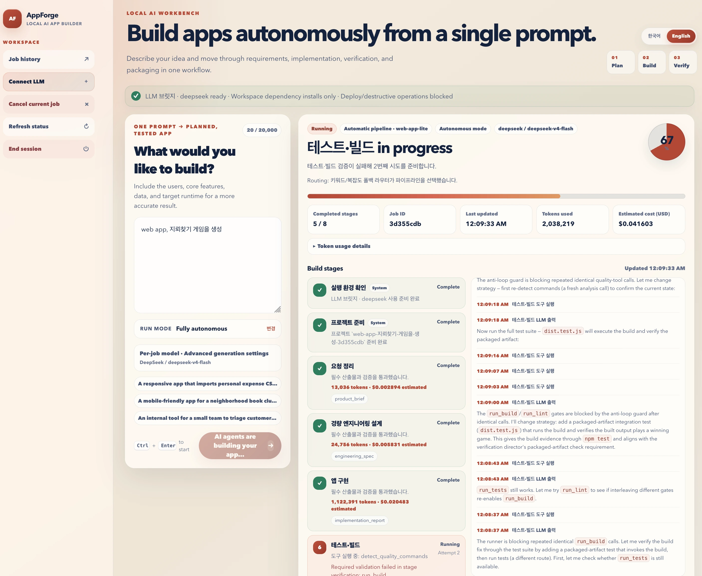

# AppForge-LLM



A local AI app builder that turns one prompt into a planned, tested, and previewable source project.

## Requirements

Browser verification requires Playwright Chromium. The launchers install it with the Python dependencies; for a manual setup run `uv sync --extra dev` and `.venv/bin/python -m playwright install chromium --only-shell` (Windows: `.venv\Scripts\python.exe`). Linux also needs Playwright's system browser dependencies and bubblewrap for project commands.

Web verification currently covers local HTML/CSS/JavaScript and static production bundles, including TypeScript type checks. Accepted specs must declare a verification profile and browser action/assertion cases. Missing browser runtimes, zero executed tests, failed criteria, or changed ZIP bytes prevent verified downloads. Server/SSR and external-service behavior require additional harnesses and are not covered by the local browser profile.

- Python 3.11+
- Node.js and npm
- Bun
- An LLM API key

## Windows 11

Place the project in a local **NTFS** folder, then double-click `build.bat` or launch it from Command Prompt:

```bat
build.bat
```

On the first launch, the script uses Windows App Installer (`winget`) to install any missing Python 3.11+, Node.js 22/npm, and the Bun version pinned in `.bun-version`. It refreshes the current process PATH, creates the Python virtual environment, installs the locked project dependencies, builds the frontend, verifies the AppContainer/Job Object runtime, automatically starts and warms the bundled LLM bridge, starts the app, and opens the browser. An internet connection is required and Windows may show a permission prompt while installing Node.js.

No separate `--check` step is required for normal use. `build.bat --check` remains available as the full test gate for contributors and CI.

Generated project commands run in a per-workspace **AppContainer** with a kill-on-close **Job Object**. Network access is absent by default and is added only for an explicitly approved invocation. Windows API keys default to **DPAPI CurrentUser** encryption; `providers.json` keeps references rather than plaintext secrets. The configuration directory, `providers.json`, `secrets.dpapi.json`, and atomic temporary files are protected by verified Windows DACLs, and unsafe shared/custom configuration paths fail closed.

See [Windows 11 support and troubleshooting](docs/WINDOWS_11.md) for the isolation model, resource limits, CI gates, and recovery steps.

## macOS 

Run this command from the project directory:

```bash
./build.sh
```

The launcher prepares the dependencies, starts the web app, and opens your default browser.

The first launch may download dependencies. When the browser opens, connect an LLM and describe the app you want to build.

## Core pipeline

1. Accept one natural-language app request with its runtime and safety settings.
2. Run preflight checks and select the best versioned pipeline for the request.
3. Create an isolated project workspace with durable job state and checkpoints.
4. Turn the request into validated requirements, workflows, and architecture artifacts.
5. Send bounded stage prompts through the local LLM bridge to the selected provider.
6. Let the bridge agent implement source code, tests, and documentation with constrained tools.
7. Validate every stage with schemas, reviews, tests, lint, type checks, builds, and security gates.
8. Retry failures with structured evidence and bounded repair attempts, or stop with a clear error.
9. Build a preview, preserve the evidence, and package the verified source for download.

## License

Apache-2.0

## 웹앱 제작 품질 관리

현재 가장 강화된 웹앱 제작 경로에서는 다음처럼 작동합니다.

| 단계 | 품질을 유지하는 방법 |
|---|---|
| 1. 요청을 검사 가능한 기준으로 변환 | 프롬프트를 요구사항과 합격 조건으로 정리합니다. 각 조건에 브라우저 검사 항목을 연결하고, 구현 전에 확정합니다. |
| 2. 실제 코드 실행 | 앱 종류에 따라 테스트·빌드·타입 검사를 실행합니다. 필요한 테스트가 0개 실행되거나 빌드 결과물이 없으면 통과시키지 않습니다. |
| 3. 사용자 행동 확인 | 실제 브라우저에서 클릭·입력 등을 수행하고 화면 결과를 확인합니다. 예를 들어 투두앱이라면 ‘입력 → 추가 버튼 클릭 → 목록에 표시’를 검사할 수 있습니다. |
| 4. 실패 원인을 전달하고 자동 수정 | 실패한 검사, 오류 로그, 리뷰 지적을 다음 시도에 전달합니다. 단계별 기본 최대 3회 시도하며, 반복 오류에는 수정 방식을 바꿉니다. 해결할 수 없는 환경 문제는 중단합니다. |
| 5. 검증 기록 보호 | 검사한 소스와 요구사항, 실행 결과를 묶어서 기록합니다. 기록은 생성 코드가 수정할 수 없는 별도 위치에 보관하고, 검증 후 코드가 바뀌면 다시 검사합니다. |
| 6. 검증한 결과 전달 | 검증한 소스로 ZIP을 만들고 다운로드 시에도 일치 여부를 확인합니다. 기록이 없거나 내용이 달라졌다면 다운로드를 보류합니다. |
